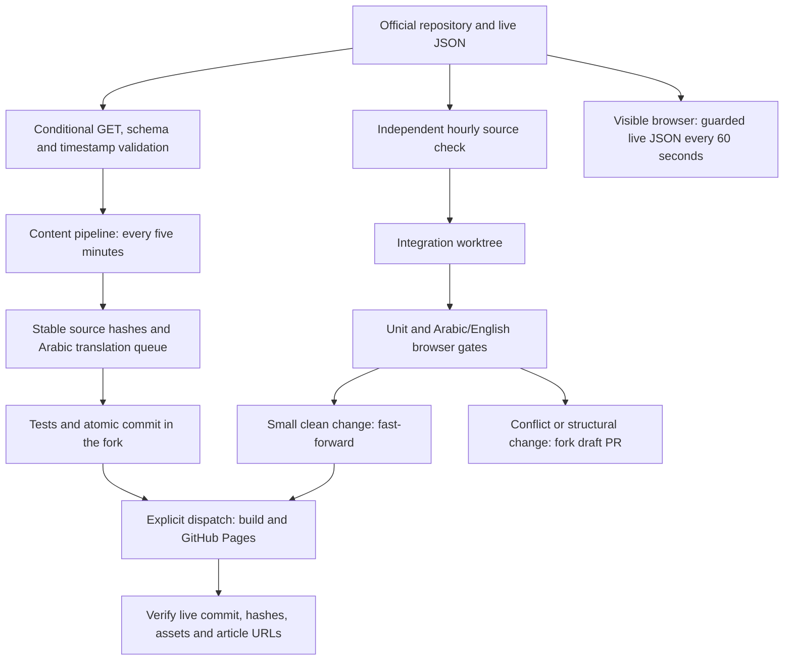

# Automatic synchronization

The fork runs independently of Codex or a personal computer. GitHub Actions is the selected free host. No upstream pull request, paid provider, server, or secret was created.

## Sources and consistency

`data/tracker.json` and `data/pinned.json` are the observed public sources. The repository commit SHA pins raw GitHub requests. The newer validated live/repository timestamp wins; invalid, regressing, duplicate or suspiciously empty snapshots retain the last good copy. Record diffs preserve original numbers, IDs, evidence, links and timestamps. Rankings remain calculated by the existing upstream scoring module; synchronization does not invent scores. `/api/live` returned HTML during discovery, so no statistics API was invented.

API Anything 0.5.0 operations were learned from actual network capture, sanitized and exported in `automation/operations/portwatch-public.json`. Tracker, pinned and interface operations were exercised; repeated `--changes` calls detected an unchanged response. The MCP stdio connection was tested with an actual tool call. Shared catalog publishing and session sharing are disabled. Canonical JSON remains usable if this supplementary operation fails. Repair is limited to supported API Anything healing and its output must pass validation.

Live loading is enabled only in the preview build. Before using remote JSON the browser compares the official scoring source hash with the deployed scoring source. It retains local data on incompatibility/error, polls visible pages every 60 seconds with backoff, and preserves selection/scroll state on refresh. Existing user input and open articles postpone refresh. A newly added article is available in the live modal before its static permalink is generated by the next successful deployment.

## Timing and hosting choices

| Option | Check interval and limitation | Cost/credentials |
|---|---|---|
| Selected GitHub Actions | Content cron five minutes; source hourly; scheduler can delay or skip runs. Build/deploy adds latency. | Public standard runners; repository GITHUB_TOKEN only |
| Selected live JSON | 60 seconds while a visitor keeps the page visible, plus network/cache time; source compatibility required | Public GET, no key; CORS verified |
| Optional Docker worker | Default 60 seconds continuously; volume persists ETags and dispatch deduplication | Requires an existing host and fork Actions-write token; not deployed because no host exists |
| Scheduled cloud worker | Platform/account dependent; a free quota is not a guaranteed service | Requires a provider account and deployment credentials; not provisioned |

No supported upstream webhook was available to this fork without upstream administration. There is no guaranteed second-level 24/7 detection in the selected hosting arrangement. Scheduled workflows can be disabled by GitHub after prolonged repository inactivity; inspect Actions if updates stop. Official documentation: [scheduled events](https://docs.github.com/en/actions/reference/workflows-and-actions/events-that-trigger-workflows#schedule).

## Arabic quality and providers

Reviewed Arabic dictionaries are authoritative and never overwritten by the content job. Interface translations are also tied to their reviewed English source to avoid stale meanings. Automatic content translations use exact English text as keys. Changed text gets a new hash and queue item; English fallback never blocks new official data.

The free offline Argos model was tested and found to mistranslate technical and idiomatic meaning. Therefore unrestricted offline results are **review drafts only**, stored in `automation/state/pending-translations.json`. Only narrow deterministic, validated phrases are automatically published. This implementation does not claim professional unattended translation of arbitrary new articles. Reviewed translations and deterministic phrases work immediately; other text remains English until approved.

The offline model costs no API credits. Its archive SHA-256 and runtime versions are pinned; only data weights/tokenizer files are extracted, never model-bundled Python pickle code. The first uncached run downloads about 89 MB. A configurable LibreTranslate endpoint is supported only with `PW_TRANSLATION_REMOTE_APPROVED=1`; availability, price, quality and credentials depend on the operator. No remote/paid translation service was enabled. ChatGPT/Codex subscriptions were not treated as API credentials.

To approve a draft, review its complete source and factual qualifiers, add it to the appropriate human dictionary, run the tests, then commit. The next sync removes its pending entry. To introduce another provider, preserve the same placeholder/number/brand guards and obtain explicit permission for costs or credentials.

## Safety, operation and recovery

Content/source jobs share a non-cancelling writer concurrency group. Pages has a separate non-cancelling deployment group. Only website changes dispatch deployment; queue/status changes alone do not rebuild. Bot commits use explicit workflow dispatch because GITHUB_TOKEN pushes do not start push workflows.

Source integration applies only the upstream source delta in a temporary branch. Large, sensitive or conflicting changes create a draft PR **inside General-c4/portwatch-vi**. Both failed tests and unresolved conflicts mark the branch review-required; preview builds refuse it. Fast-forward pushes only, no force push. The fork-only Actions PR permission was enabled with the owner's explicit approval.

Monitor Actions artifacts `content-sync-status`, `source-sync-status` and `deployment-verification`; status includes checked/integrated/deployed SHA, timestamps, diff counts, provider/coverage/pending, errors, retries and measured pipeline durations. Public UI contains no operational dashboard. Queue and source state persist in Git; private HTTP bodies and capture state stay under ignored `.sync`.

Transient HTTP failures retry with bounded exponential backoff and Retry-After handling. Locks recover dead processes. Invalid data cannot replace the last good snapshot. Deployment verifies the real live commit and data hash after CDN propagation. Failed Pages service attempts retry once; if both fail the workflow attempts restoration of the previous successful tested Pages artifact. The failed new release remains red. If artifacts have expired, existing Pages remains untouched and recovery requires an available tested artifact. No tests or environment protections are bypassed.

Manual operation: `gh workflow run content-sync.yml --ref feat/arabic-rtl-localization`, or `source-sync.yml` for source checks, or `arabic-preview.yml` for deployment. Review `.sync`/Actions artifacts before retrying persistent failures. Rotate a Docker dispatch token if that optional worker is ever deployed. Never commit tokens or API Anything captured sessions.

## Verification evidence

- 18 Node tests passed: conditional 304, rate limits, network timeout, invalid JSON, source rejection, exact-hash queues, new static dashboard labels, protected facts, provider failure, locks/restarts, worker deduplication, real Git conflict, transactional content synchronization and deployment/CDN failure handling.
- Real source browser gate passed Arabic/English at 1920, 768, 390 and 360 pixel widths, including filters, sort, dialogs, direction, JavaScript errors and overflow.
- Browser fixture exercised new/changed/deleted remote records, new news, English fallback, state preservation and rejection of a corrupt next response. Measured detection plus reload: 1,083 ms with a deliberately shortened 1,000 ms test poll; production remains 60,000 ms. This is not a production 1-second claim.
- Real content cycle measured source check 1,060 ms, translation/draft work 23,734 ms, total 24,804 ms. These are execution durations, not scheduler wait guarantees. Current reports measure data persistence separately from source detection and translation; an earlier cumulative synchronization counter was corrected. Deployment duration is recorded separately in the deployment status artifact.
- Docker runtime deployment and an actual remote rollback were not exercised; no server was available and no deliberate production failure was introduced.

Principal files: the three workflows; `automation/content-sync.mjs`, `source-sync.mjs`, `worker.mjs`; `automation/lib/*`; pinned operations/runtime/model loader; persistent `automation/state/*`; browser `live-data.js`, `tracker-source.js`, `sync-config.js`; Arabic source/automatic catalogs; preview build/deployment verifier; Dockerfile/compose; synchronization and deployment tests. Original human dictionaries, RTL and design are retained. Current upstream GPU badges/image were integrated; a long marker label was clamped within the viewport to fix observed mobile overflow.
